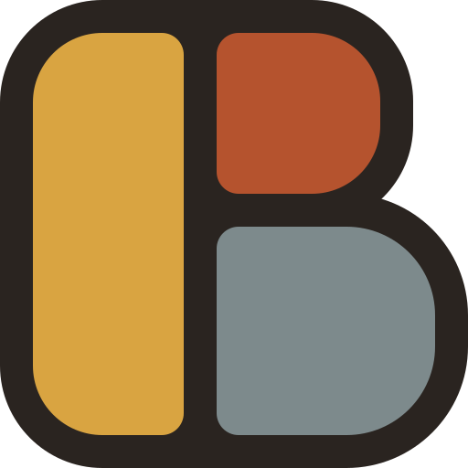
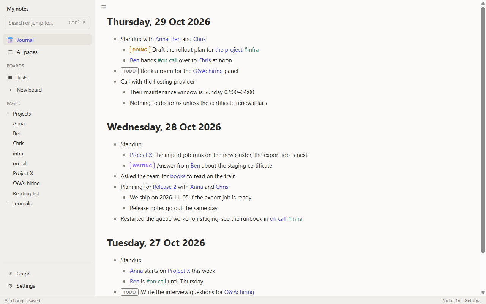
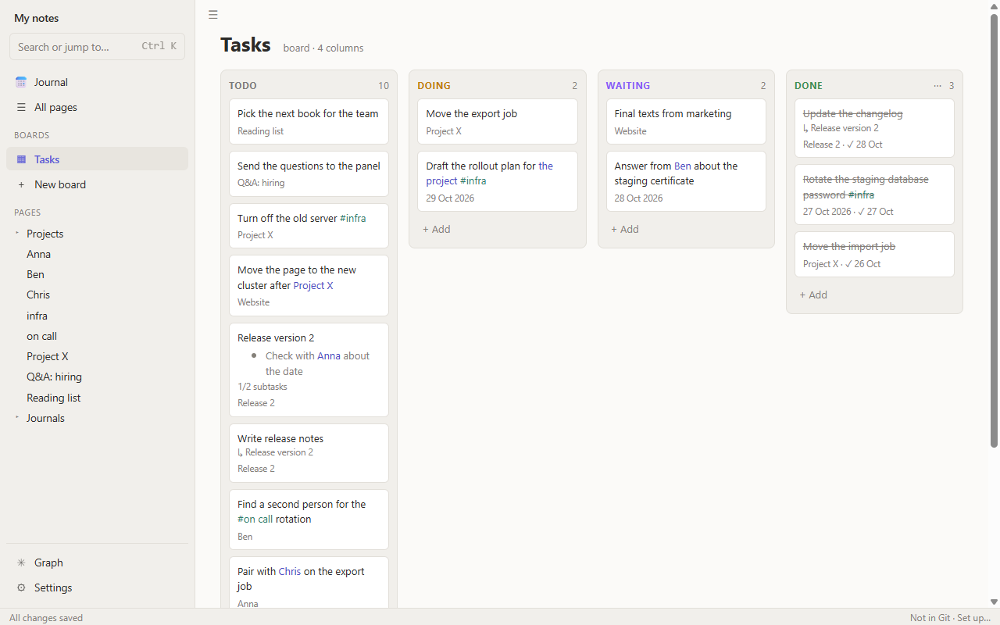

# Breccia

> Breccia is a rock made of broken fragments cemented together into one stone.
> Breccia is a notes app where the fragments of everyday work and tasks bind into one body of knowledge.



Breccia is a local-first outliner for the desktop: a lean, personal take on Logseq. You write in a daily journal and in
pages, as nested bullets. Any bullet can be a task, and every task in every file shows up as a card on a Kanban board.
Your notes stay plain Markdown files in a folder you choose; there is no account or server, and your notes are not
kept in a database.

It is made for one person who keeps daily notes and tasks in one place and wants to own the files.

## Features

- **Journal**: one file per day, shown as a scrolling feed with today on top. Jump to any date by typing it into
  search (`12 Mar`, `yesterday`) or with the date picker next to "Journal" (`Ctrl Shift D`), including days without
  an entry.
- **Pages** with `[[links]]` and `#tags`. Each page lists its linked references: every block elsewhere that links to it.
  The sidebar's Tags section lists every tag with the number of blocks that have it; a tag can be renamed there.
- **Tasks**: a block starting with a state keyword (`TODO`, `DOING`, `DONE`, …) is a task. The states are configurable,
  and `Ctrl Enter` cycles through them (`Ctrl Shift Enter` removes the state). A task records when it got its state (a `created::` line), and a finished one
  shows when it was done and how long it took (`✓ 3 Nov 14:05 after 3 days`).
- **Kanban boards** over every task block in the folder: each column shows the tasks in one state. Dragging a card
  to another column changes the state in its file; dropping it at a place in a column keeps that place (a
  `priority::` number in the notes; such cards stay on top, highest first). Archiving a card hides it from the board
  and keeps its state (an `archived::` line in the notes). Finished tasks done more than 14 days ago are archived by themselves (Settings → Boards sets the
  days or turns it off). Archive in the sidebar lists every archived task; changing a task's state brings it back.
- **All pages**: a table of every page, to sort and filter. A page that is only linked to, with no text of its own
  yet, is listed too, in italics, here and in the sidebar.
- **Zoom** the whole window with `Ctrl +`, `Ctrl −` and `Ctrl 0`; the level is kept per computer.
- **Keyboard**: `F1` shows every keyboard shortcut in an overlay, grouped, with a filter (also the `?` button at the bottom right). `Alt ←` / `Alt →` (or the ← → buttons at the top
  left) go back and forward between views.
- **Search** (`Ctrl K`) over page names and block text, with `#tag` and state filters.
- **Git sync**: if the folder is a Git repository, Breccia commits your changes a few minutes after you stop typing,
  and pulls and pushes when it has a remote. The history button next to the Git item in the status bar lists the
  folder's commits, newest first.
- **Six themes** (Light, Dark, Violet, Graphite, Taupe, Teal), plus System, which follows Windows.
- **Graph** of the pages and the links between them.
- **Tray icon** (Windows): the close button hides Breccia to the tray, so it is always at hand. Click the icon to open it again; the icon's menu has Open and Exit. Exit closes the app for real.



## Install

Breccia runs on Windows only for now.

1. Open the [Releases page](https://github.com/EightBitBoy/breccia/releases) of the GitHub repository.
2. Download `Breccia_X.Y.Z_x64-setup.exe` from the newest release and run it. It installs for the current user only,
   with no admin prompt, and adds a Start-menu entry.
3. The installer is not code signed, so Windows SmartScreen warns on the first run. Click "More info", then
   "Run anyway".

Breccia needs Microsoft WebView2, which Windows 11 already has. If it is missing, the installer downloads it, so the
first install needs an internet connection.

## Your notes

On first start, Breccia asks for a notes folder: open an existing one or create a new one. Everything lives there:

```text
notes/
  journals/2026-10-29.md   one file per day
  pages/Project X.md       one file per page
  breccia/config.toml      task states, boards and other settings
```

Every file is plain Markdown, so you can read and edit your notes in any text editor, back them up as you like, and keep
them in Git. Breccia never reformats text you wrote; it only saves line endings as LF (a Windows CRLF file becomes LF
the first time Breccia saves it).

- [The notes format](docs/format.md) describes the folder and the files exactly, for anyone who wants to write a
  compatible app.
- [Breccia, Obsidian and Logseq](docs/compatibility.md) compares the three and says how to open a Breccia folder in
  Obsidian or Logseq.
- [`docs/demo/`](docs/demo/) is a small sample folder; the screenshots above show it.

## Build from source

You need Windows 11, Rust 1.90, Node 24, [just](https://github.com/casey/just) and WebView2. Then:

```sh
cd app
npm install
cd ..
just dev       # run the app in dev mode, on a fresh copy of docs/demo (your settings stay untouched)
just test      # frontend build, Vitest, cargo test
just lint      # cargo fmt --check, clippy, svelte-check
just e2e       # build the release exe and drive it end to end
just build     # the release exe
just bundle    # the Windows installer
```

[Releasing](docs/releasing.md) says how a release is cut, and the [changelog](CHANGELOG.md) lists what changed in each
version.

## How it is developed

Breccia is built by its owner together with Claude Code. Each change is planned, reviewed by the owner, and carried
out task by task, with a review after every task and a final review of the whole change.

- [The design spec](docs/spec.md) is the binding description of what the app does and why.
- [The notes format](docs/format.md) and [Breccia, Obsidian and Logseq](docs/compatibility.md) describe the files.
- [Releasing](docs/releasing.md) says how a release is cut.
- [The backlog](docs/backlog.md) collects ideas not yet planned.
- [`docs/STATUS.md`](docs/STATUS.md) and [`CLAUDE.md`](CLAUDE.md) are the entry points for working on Breccia: they say
  how the work is done, what is finished and what comes next.

## License

Breccia is released under the [MIT License](LICENSE).
